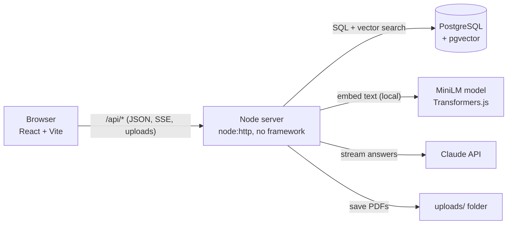
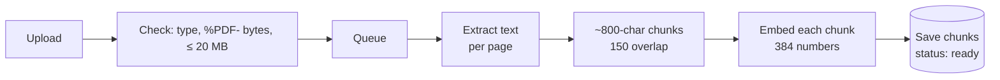
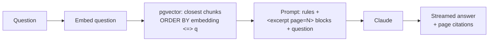

# 📄 Chat with your Doc

Upload a PDF, then **ask questions about it** in a ChatGPT-style chat. Answers are based only on your document and **cite the pages** they came from. You can also **search the document by meaning**, which uses no AI calls and costs nothing.

The backend is written in **plain Node.js with no web framework** (no Express). The router, JSON body parsing, CORS, file uploads, streaming and error handling are all built by hand on top of `node:http`.

<!-- Screenshots: add images to docs/screenshots/ and uncomment these lines.


-->

---

## ✨ Features

- **Upload PDFs** (📎). They are processed in the background: text per page → chunks → embeddings, with a live *Processing… / Ready* badge.
- **Chat about a document (RAG).** The most relevant passages are found and sent to Claude with strict rules: answer only from them, cite pages like `[p. 3]`, and say so when the answer isn't there.
- **Citations** under each answer (`📄 p. 3`). Hover one to see the excerpt that was used.
- **🔍 Search tab:** semantic search in about 10 ms. It finds "revenue grew" when you type *"did the company make more money?"*.
- **Suggested starter questions**, generated once per document and then cached.
- **Streaming replies**, word by word over Server-Sent Events, with a **Stop** button that cancels the AI request on the server too.
- **Chat history** saved in PostgreSQL, so it survives a page refresh.
- **Light, dark and system themes**, a phone layout, and keyboard focus styles.
- **Fake mode** (`FAKE_LLM=true`): run everything without an API key. Document chats then show the exact prompt Claude would receive.

## 🧱 Tech stack

| Part | Technology |
|---|---|
| Frontend | React 19, Vite, Tailwind CSS 4, react-markdown |
| Backend | Node.js 22.9+ (`node:http`, ES modules), **no framework** |
| Database | PostgreSQL 16 + **pgvector** (in Docker), `pg` driver with plain SQL |
| AI answers | Claude (`@anthropic-ai/sdk`), streamed |
| Embeddings | `Xenova/all-MiniLM-L6-v2` via Transformers.js. It runs **locally**, for free (384 dimensions) |
| PDF text | `unpdf` (Mozilla PDF.js) |
| Tests | Node's built-in test runner (`node --test`) |

---

## 🏗️ How it works



**Uploading a PDF.** The upload request answers immediately, and the slow work runs in a background queue:



**Asking a question (RAG).**



When no chunk scores above the cutoff (broad questions like *"What is this about?"*, or dense text that scores low), Claude gets the closest chunks **plus an evenly spaced sample of the whole document** as general context.

---

## 🚀 Getting started

**You need:** Node.js 22.9+, Docker, and optionally an [Anthropic API key](https://console.anthropic.com). Without a key, use fake mode.

```bash
git clone https://github.com/charishmalakshmipagadala/chat-with-your-doc.git
cd chat-with-your-doc

# 1. Start the database (PostgreSQL + pgvector)
docker compose up -d

# 2. Backend
cd backend
cp .env.example .env        # then edit .env: add your key, or set FAKE_LLM=true
npm install
npm run migrate             # creates the tables (safe to run again)
npm run dev                 # http://localhost:3001

# 3. Frontend (in a second terminal)
cd frontend
npm install
npm run dev                 # open http://localhost:5173
```

The first upload downloads the embedding model (about 90 MB, once). It is cached in `backend/.cache/`.

### Settings (`backend/.env`)

| Variable | Meaning |
|---|---|
| `DATABASE_URL` | Postgres connection string (the default matches `docker-compose.yml`) |
| `ANTHROPIC_API_KEY` | Your Claude API key. Not needed when `FAKE_LLM=true` |
| `FAKE_LLM` | `true`: fake streamed replies, with no Claude calls and no cost |
| `CLAUDE_MODEL` | Optional. Default `claude-sonnet-5-5` |
| `PORT` | Backend port. Default `3001` |

### Tests

```bash
cd backend
npm test          # 33 tests: router, chunking, RAG prompt, and the full retrieval pipeline
```

The retrieval tests run the real pipeline (PDF → chunks → embeddings → Postgres → search) on a generated 4-topic PDF, and check that each question finds the right page. Without a database they are **skipped**, not failed.

---

## 🛣️ API

| Method | Path | What it does |
|---|---|---|
| `GET` | `/api/health` | Server and database status |
| `POST` | `/api/documents` | Upload a PDF (`multipart/form-data`, field `file`) |
| `GET` | `/api/documents` | List documents |
| `GET` | `/api/documents/:id` | One document's status (the frontend polls this) |
| `GET` | `/api/documents/:id/search?q=&limit=` | Semantic search, no AI |
| `GET` | `/api/documents/:id/suggestions` | Starter questions (cached) |
| `POST` | `/api/conversations` | Create a chat (`{ documentId }` optional) |
| `GET` | `/api/conversations` | List chats |
| `GET` | `/api/conversations/:id/messages` | A chat with its messages and sources |
| `DELETE` | `/api/conversations/:id` | Delete a chat |
| `POST` | `/api/chat` | `{ conversationId, content }` → **SSE stream**: `{text}` … `{sources}` … `[DONE]` |

Errors are JSON: `{ "error": "…" }` with `400`, `404`, `405` (+ `Allow`), `409`, `413` or `415`. Unexpected errors return `500` with a **reference id** that matches the server log (`X-Request-Id`).

---

## 🤔 Why no Express?

Frameworks are great, but they hide how HTTP actually works. Building the pieces by hand was the point:

| Express gives you | Built here in |
|---|---|
| Routing with `:params` | [`lib/router.js`](backend/src/lib/router.js) turns `/api/x/:id` into a regex with named groups. It also answers `405` for wrong methods |
| `express.json()` | [`lib/http.js`](backend/src/lib/http.js) `readJson`: collects the streamed body with `for await`, with a 1 MB limit |
| `multer` (uploads) | [`lib/upload.js`](backend/src/lib/upload.js) wraps `req` in a web `Request` and uses the built-in `formData()`. The 20 MB limit is enforced while the bytes stream in |
| `cors()` | `setCors()` plus `OPTIONS` preflight handling |
| Error middleware | One `try/catch` in [`server.js`](backend/src/server.js). Only `HttpError`s reach users |
| Streaming responses | [`lib/sse.js`](backend/src/lib/sse.js): Server-Sent Events by hand |

The whole server is about 1,600 lines of readable JavaScript, and every request can be traced from `http.createServer` to the database.

---

## 🧠 Design decisions

- **The server is the source of truth.** `/api/chat` receives only `{ conversationId, content }` and loads the history from the database, so a browser can't inject fake history.
- **Strict RAG prompt.** A fixed system prompt (no user text in it): answer only from the excerpts, cite pages, say "couldn't find it" instead of guessing, and **ignore instructions that appear inside the document** (prompt-injection defence).
- **Background processing.** Uploads answer right away. A one-at-a-time queue does the heavy work. Saving is **idempotent** (old chunks are deleted first, everything is in one transaction), and unfinished documents are **resumed after a restart**.
- **Local embeddings.** They are free, private, and need no second API key.
- **Defence in depth on uploads.** A content-type check, a `%PDF-` magic-byte check, a size limit counted while streaming, and random file names on disk (no path traversal).
- **Fail fast.** A missing setting or an unreachable database stops the server at startup with a clear message.
- **Clean shutdown.** Ctrl+C closes connections and the database pool, so the port is freed straight away.

## 🐛 Bugs found by testing (and fixed)

Testing on purpose, including with real documents, found real problems:

- **The search cutoff was tuned on clean data.** On a dense resume, the right chunk ranked *first* but scored only 0.155, below the 0.25 cutoff. The fix also sends the closest chunks when nothing passes the cutoff.
- **The "spread" sample wasn't spread.** `Math.floor(7 / 4) = 1` sampled chunks 0–3, so the end of the document was never seen. Fixed with evenly spaced indices (`[0, 2, 4, 6]`).
- **Broad questions found nothing.** *"What is this document about?"* matches no single chunk. Fixed with a whole-document sample as context.
- **Error details could leak.** The error handler trusted any `err.status`, and SDK errors have one too. Now only our own `HttpError` is shown to users.
- **NUL characters crashed saves.** Postgres text can't store `\u0000`, and some PDFs contain it. It is now stripped from all text.
- **Message order could shuffle.** Rows saved in one transaction share the same `now()` timestamp. Fixed with an auto-incrementing id.
- **Low contrast.** The hint text measured 4.2:1 (WCAG asks for 4.5:1). Fixed, and both themes were measured.

## ⚠️ Limitations

- No login. Everyone using one server shares the chats and documents.
- One document per chat. PDFs only, and scanned PDFs (images of text) aren't supported yet.
- Files are stored on local disk (`backend/uploads/`), not cloud storage.

## 📁 Project structure

```
chat-with-your-doc/
├── docker-compose.yml          # PostgreSQL 16 + pgvector
├── backend/
│   ├── src/
│   │   ├── server.js           # http.createServer → CORS → router → error handler
│   │   ├── config.js           # settings from .env, checked at startup
│   │   ├── lib/                # router, http helpers, SSE, uploads (what Express would give)
│   │   ├── db/                 # pool, schema.sql, migrate.js
│   │   ├── routes/             # chat, conversations, documents
│   │   └── services/           # llm, parser, embeddings, ingest, retrieval, ragPrompt, suggestions
│   └── tests/                  # node --test (unit + integration)
└── frontend/
    └── src/
        ├── api/client.js       # every backend call + SSE stream reader
        ├── hooks/              # useChat, useDocuments, useTheme
        └── components/         # Sidebar, ChatWindow, MessageBubble, SearchPanel, …
```
